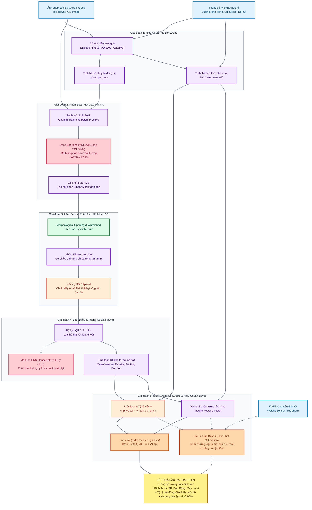

# 🌾 Rice Vision AI — Hệ Thống Tự Động Đo Kích Thước & Ước Lượng Số Lượng Hạt Gạo

> **ĐỒ ÁN NGHIÊN CỨU KHOA HỌC / BÁO CÁO HỌC THUẬT**  
> **Đề tài:** Ứng dụng Thị giác Máy tính (Computer Vision), Mô hình Hình học 3D Ellipsoid, Học máy (Machine Learning) và Hiệu chuẩn Thống kê Bayes (Bayesian Few-Shot Calibration) để tự động nhận dạng, đo đạc kích thước hình học và ước lượng chính xác số lượng hạt nông sản theo từng mẻ chứa.

---

## 📑 Mục Lục
1. [Giới Thiệu Tổng Quan](#-1-giới-thiệu-tổng-quan)
2. [Sơ Đồ Luồng Hoạt Động & Kiến Trúc Hệ Thống (Pipeline Flowchart)](#-2-sơ-đồ-luồng-hoạt-động--kiến-trúc-hệ-thống-pipeline-flowchart)
3. [Dự Án Trọng Tâm: AI_SERVICES (Full-Stack Production Package)](#-3-dự-án-trọng-tâm-ai_services-full-stack-production-package)
   - [Kiến trúc 3 tầng của AI_SERVICES](#kiến-trúc-3-tầng-của-ai_services)
   - [Các cách thức vận hành hệ thống (3 phương thức)](#các-cách-thức-vận-hành-hệ-thống)
4. [Bản Đồ Số Liệu Thực Nghiệm & Biểu Đồ Đối Sánh (Paper Benchmarks)](#-4-bản-đồ-số-liệu-thực-nghiệm--biểu-đồ-đối-sánh-paper-benchmarks)
   - [Thư mục tổng hợp số liệu sạch PAPER_BENCHMARKS/](#thư-mục-tổng-hợp-số-liệu-sạch-paper_benchmarks)
   - [Bảng ma trận đối chiếu 4 tầng nghiên cứu & Tái lập kết quả](#bảng-ma-trận-đối-chiếu-4-tầng-nghiên-cứu--tái-lập-kết-quả)
5. [Cấu Trúc Toàn Bộ Kho Mã Nguồn (Repository Layout)](#-5-cấu-trúc-toàn-bộ-kho-mã-nguồn-repository-layout)
6. [Hướng Dẫn Cài Đặt & Khởi Chạy Nhanh (Quick Start)](#-6-hướng-dẫn-cài-đặt--khởi-chạy-nhanh-quick-start)
7. [Thông Tin Tác Giả & Giảng Viên Hướng Dẫn](#-7-thông-tin-tác-giả--giảng-viên-hướng-dẫn)

---

## 📌 1. Giới Thiệu Tổng Quan

Trong ngành quản lý chất lượng nông sản xuất khẩu, việc xác định số lượng và kích thước hình học hạt lúa/gạo thường đòi hỏi máy đếm quang học đắt tiền hoặc kiểm đếm thủ công tốn thời gian.

**Hệ thống Rice Vision AI** giải quyết bài toán này bằng một giải pháp thông minh, chi phí thấp với quy trình xử lý khép kín:
1. **Chuẩn hóa hệ đo lường quang học:** Sử dụng ảnh chụp từ trên xuống của ly/cốc chứa mẫu lúa. Thuật toán thị giác tự động phát hiện viền miệng ly (bằng Ellipse Fitting & RANSAC) làm vật chuẩn để tính toán tỷ lệ thực tế `pixel_per_mm` và thể tích khối hạt gạo bên trong ly ($V_{\text{bulk}}$).
2. **Phân đoạn hạt bằng Trí tuệ Nhân tạo:** Sử dụng mạng nơ-ron tích chập **YOLOv8-Seg / YOLO26s** kết hợp kỹ thuật cắt lát mỏng **SAHI (Slicing Aided Hyper Inference)** để phát hiện từng hạt gạo rời rạc với độ chính xác cao trên ảnh độ phân giải lớn mà không làm mất hạt nhỏ.
3. **Mô hình hóa hình học 3D Ellipsoid:** Tách biên hạt dính chùm bằng Morphological Opening & Distance-Watershed, khớp elip 2D để đo trục lớn/trục bé, và nội suy bán trục thứ ba để tính thể tích hình học từng hạt ($V_{\text{grain}}$), phân loại hạt đồng đều và loại bỏ hạt vỡ qua ngưỡng IQR.
4. **Ước lượng số lượng Hybrid kết hợp Hiệu chuẩn Bayes:** Kết hợp 3 cơ chế:
   - *Ước lượng tỷ lệ vật lý:* $N_{\text{physical}} = V_{\text{bulk}} / V_{\text{grain\_mean}}$
   - *Mô hình học máy dạng bảng:* **Extra Trees Regressor** huấn luyện trên 31 đặc trưng hình học đạt độ chính xác cực cao ($R^2 = 0.9994$, $\text{MAE} = 1.79$ hạt).
   - *Hiệu chuẩn Few-Shot Bayes (Bayesian Calibration):* Khắc phục hiện tượng dịch chuyển phân phối giữa các mẻ lúa khác nhau, ước lượng kèm **khoảng tin cậy 90%** (90% Uncertainty Interval) chỉ với $1 - 5$ mẫu cân thử nghiệm ban đầu.

---

## 🏛️ 2. Sơ Đồ Luồng Hoạt Động & Kiến Trúc Hệ Thống (Pipeline Flowchart)

Toàn bộ quy trình từ khâu thu thập ảnh đến khi xuất báo cáo kết quả được mô tả trong biểu đồ dưới đây:



---

## 💻 3. Dự Án Trọng Tâm: AI_SERVICES (Full-Stack Production Package)

Thư mục [`AI_SERVICES/`](file:///d:/GG_1/NGHIÊN%20CỨU%20KHOA%20HỌC/GROUP_MEMBERS/NGUYEN%20MINH%20TRI/MAIN_SOURCES/AI_SERVICES) là **sản phẩm hoàn chỉnh, độc lập và trung tâm** của toàn bộ đề tài. Toàn bộ các thuật toán xử lý ảnh, mô hình AI, máy chủ API, cơ chế thu ảnh điện thoại và giao diện Web đều được tích hợp tại đây.

### Kiến Trúc 3 Tầng Của `AI_SERVICES`

```text
               ┌────────────────────────────────────────────────────────┐
               │         GIAO DIỆN NGƯỜI DÙNG WEB (Port 5173)           │
               │   React 19 + TypeScript + Vite + TailwindCSS           │
               │   Hỗ trợ Responsive tối ưu trên cả Máy tính & Di động  │
               └───────────────────────────┬────────────────────────────┘
                                           │ (1) Gửi ảnh & thông số cốc lúa
                                           ▼
               ┌────────────────────────────────────────────────────────┐
               │         API GATEWAY TRUNG GIAN (Port 3000)             │
               │   Node.js + Express (Xử lý tải file & Điều phối API)   │
               └───────────────────────────┬────────────────────────────┘
                                           │ (2) Chuyển tiếp ảnh
                    ┌──────────────────────┴──────────────────────┐
                    │ (Chế độ Local)                              │ (Chế độ Cloud GPU)
                    ▼                                             ▼
┌───────────────────────────────────────┐   ┌───────────────────────────────────────┐
│     AI SERVER LOCAL (Port 8000)       │   │    GOOGLE COLAB GPU RUNTIME (Tesla T4)│
│ Python FastAPI + PyTorch + OpenCV     │   │   Kết nối qua Ngrok Tunnel an toàn    │
│ • Container Detector (Adaptive Rim)   │   │ • SAHI + YOLOv8-Seg siêu tốc (~1s)    │
│ • SAHI + YOLOv8-Seg (Inference)       │   │ • Extra Trees Regressor & Bayes       │
│ • 31-Feature Extraction & Extra Trees │   │ • Trả kết quả JSON siêu tốc           │
└───────────────────────────────────────┘   └───────────────────────────────────────┘
                    ▲
                    │ (3) Kết nối chụp ảnh trực tiếp từ camera điện thoại
┌───────────────────────────────────────────────────────────────────────────────────┐
│              PHONE CAMERA CAPTURE SERVER (Port 8765 / WebSocket HTTPS)            │
│   Quét mã QR bằng điện thoại -> Biến camera điện thoại thành mắt chụp cho hệ thống │
└───────────────────────────────────────────────────────────────────────────────────┘
```

---

### Các Cách Thức Vận Hành Hệ Thống

Hệ thống được thiết kế để giảng viên và người dùng có thể chạy linh hoạt theo **3 phương thức** tùy theo điều kiện phần cứng:

#### 🟢 Cách 1: Vận hành Thuần Local — 1-Click Startup (Khuyên dùng hằng ngày)
- **Đặc điểm:** Chạy hoàn toàn Offline 100% trên máy tính, không cần internet, bảo mật tuyệt đối.
- **Cách khởi động nhanh nhất (Dành cho Giảng viên):**
  1. Vào thư mục [`AI_SERVICES/SYSTEM_LAUNCHER/`](file:///d:/GG_1/NGHIÊN%20CỨU%20KHOA%20HỌC/GROUP_MEMBERS/NGUYEN%20MINH%20TRI/MAIN_SOURCES/AI_SERVICES/SYSTEM_LAUNCHER).
  2. Kích đúp vào file **`START_ALL_1_CLICK.bat`**.
  3. Hệ thống sẽ tự động bật đồng thời cả 3 dịch vụ (AI FastAPI Port 8000, Node.js Gateway Port 3000, Web React Port 5173) và **tự động mở trình duyệt web** tại địa chỉ `http://localhost:5173`.
  4. Khi muốn tắt toàn bộ hệ thống sạch sẽ: Kích đúp vào **`STOP_ALL_SYSTEM.bat`**.
- **Nếu chạy thủ công từng phần bằng dòng lệnh:**
  ```bash
  # Terminal 1: Chạy AI Inference Server
  cd AI_SERVICES
  .venv\Scripts\activate
  uvicorn app.main:app --host 0.0.0.0 --port 8000 --reload

  # Terminal 2: Chạy API Gateway Node.js
  cd AI_SERVICES/RICE_ESTIMATION_APPLICATION/backend
  npm install && node server.js

  # Terminal 3: Chạy Web Frontend React
  cd AI_SERVICES/RICE_ESTIMATION_APPLICATION/frontend
  npm install && npm run dev
  ```

---

#### ☁️ Cách 2: Vận hành Kết Hợp Cloud GPU (Google Colab T4 + Ngrok)
- **Đặc điểm:** Dành cho máy tính cá nhân không có card đồ họa NVIDIA. Toàn bộ phần tính toán nặng (YOLO + CNN) được đẩy lên GPU Tesla T4 miễn phí của Google Colab, thời gian phân tích giảm xuống chỉ còn **~1.5 – 3 giây/ảnh**.
- **Cách thực hiện:**
  1. Mở file [AI_SERVICES/src/notebooks/API_Server.ipynb](file:///d:/GG_1/NGHIÊN%20CỨU%20KHOA%20HỌC/GROUP_MEMBERS/NGUYEN%20MINH%20TRI/MAIN_SOURCES/AI_SERVICES/src/notebooks/API_Server.ipynb) trên [Google Colab](https://colab.research.google.com/).
  2. Chọn phần cứng **GPU T4** và chạy các Cell để khởi tạo server và lấy URL công khai dạng `https://xxxx.ngrok-free.app`.
  3. Mở file [AI_SERVICES/.env](file:///d:/GG_1/NGHIÊN%20CỨU%20KHOA%20HỌC/GROUP_MEMBERS/NGUYEN%20MINH%20TRI/MAIN_SOURCES/AI_SERVICES/.env) trên máy, điền đường dẫn `AI_SERVER_URL=https://xxxx.ngrok-free.app`.
  4. Bật giao diện Web (`2_START_WEB_DASHBOARD.bat`) trên máy tính để trải nghiệm tốc độ xử lý tức thì.

---

#### 🧪 Cách 3: Chạy Kiểm Thử Tự Động Toàn Diện (Automated CLI / Pytest)
- **Đặc điểm:** Đánh giá tự động chất lượng thuật toán và độ chính xác của toàn bộ luồng xử lý trên các bộ dữ liệu thực tế mà không cần mở giao diện Web.
- **Lệnh thực hiện:**
  ```bash
  cd AI_SERVICES
  .venv\Scripts\activate

  # 1. Kiểm thử End-to-End toàn diện trên ảnh thực tế và đối chiếu Ground Truth
  pytest tests/test_real_pipeline.py -v

  # 2. Kiểm thử tính toàn vẹn của Feature Schema 31 biến và Regression Loader
  pytest tests/test_feature_schema.py tests/test_regression_loader.py -v

  # 3. Kiểm thử giải thuật hiệu chuẩn Bayes (Bayesian Estimators)
  pytest tests/test_bayes_estimators.py tests/test_bayes_integration.py -v

  # 4. Chạy toàn bộ test suite (Toàn bộ 16 file kiểm thử hệ thống)
  pytest
  ```

---

## 📊 4. Bản Đồ Số Liệu Thực Nghiệm & Biểu Đồ Đối Sánh (Paper Benchmarks)

Nhằm phục vụ viết bài báo khoa học và giúp Giảng viên/Người phản biện dễ dàng thẩm định kết quả, toàn bộ số liệu đo đạc, bảng so sánh mô hình và biểu đồ độ phân giải cao đã được tập hợp sạch sẽ tại:

👉 **Thư mục tổng hợp:** [`PAPER_BENCHMARKS/`](file:///d:/GG_1/NGHIÊN%20CỨU%20KHOA%20HỌC/GROUP_MEMBERS/NGUYEN%20MINH%20TRI/MAIN_SOURCES/PAPER_BENCHMARKS) *(Dung lượng chỉ ~15.5 MB, không chứa checkpoint nặng)*

---

### Bảng Ma Trận Đối Chiếu 4 Tầng Nghiên Cứu & Tái Lập Kết Quả

| Tầng nghiên cứu trong bài báo | Nội dung & Mô hình đánh giá | Kết quả cốt lõi | File Bảng biểu & Biểu đồ sạch (Xem ngay tại `PAPER_BENCHMARKS/`) | Mã nguồn / Script chạy tái lập thí nghiệm |
| :--- | :--- | :--- | :--- | :--- |
| **1. Phân đoạn hạt gạo (Instance Segmentation)** | So sánh 8 mô hình: YOLOv8 (nano, small, medium), YOLOv10 (nano, small), YOLO26s, YOLOv12-MobileSAM | **YOLOv8m** & **YOLO26s** đạt độ chính xác cao nhất ($mAP50 = 97.56\%$, $F1 = 0.959$). Tốc độ suy luận đạt tiêu chuẩn thời gian thực. | • [`01_segmentation_benchmarks/benchmark_summary_all_models.csv`](file:///d:/GG_1/NGHIÊN%20CỨU%20KHOA%20HỌC/GROUP_MEMBERS/NGUYEN%20MINH%20TRI/MAIN_SOURCES/PAPER_BENCHMARKS/01_segmentation_benchmarks/benchmark_summary_all_models.csv)<br>• [`01_segmentation_benchmarks/benchmark_summary_tables.xlsx`](file:///d:/GG_1/NGHIÊN%20CỨU%20KHOA%20HỌC/GROUP_MEMBERS/NGUYEN%20MINH%20TRI/MAIN_SOURCES/PAPER_BENCHMARKS/01_segmentation_benchmarks/benchmark_summary_tables.xlsx)<br>• Thư mục biểu đồ: [`01_segmentation_benchmarks/charts/`](file:///d:/GG_1/NGHIÊN%20CỨU%20KHOA%20HỌC/GROUP_MEMBERS/NGUYEN%20MINH%20TRI/MAIN_SOURCES/PAPER_BENCHMARKS/01_segmentation_benchmarks/charts/) *(Radar chart, Pareto frontier, PR curves)* | [`RESULTS/Segmentation Model Results/SEGMENTATION_MODELS_BENCHMARK.ipynb`](file:///d:/GG_1/NGHIÊN%20CỨU%20KHOA%20HỌC/GROUP_MEMBERS/NGUYEN%20MINH%20TRI/MAIN_SOURCES/RESULTS/Segmentation%20Model%20Results/SEGMENTATION_MODELS_BENCHMARK.ipynb) |
| **2. Học máy dự đoán số hạt (Tabular Regression)** | So sánh 16 thuật toán: ExtraTrees, GradientBoosting, Random Forest, ARD, Bayesian Ridge, ElasticNet, Huber, OLS... | **Extra Trees Regressor** (100 trees) đứng đầu toàn diện:<br>• $R^2 = 0.9994$<br>• $\text{MAE} = 1.79$ hạt<br>• $\text{MAPE} = 1.28\%$ | • [`02_regression_benchmarks/comparison.csv`](file:///d:/GG_1/NGHIÊN%20CỨU%20KHOA%20HỌC/GROUP_MEMBERS/NGUYEN%20MINH%20TRI/MAIN_SOURCES/PAPER_BENCHMARKS/02_regression_benchmarks/comparison.csv)<br>• [`02_regression_benchmarks/data_quality_report.json`](file:///d:/GG_1/NGHIÊN%20CỨU%20KHOA%20HỌC/GROUP_MEMBERS/NGUYEN%20MINH%20TRI/MAIN_SOURCES/PAPER_BENCHMARKS/02_regression_benchmarks/data_quality_report.json)<br>• [`02_regression_benchmarks/split_membership.csv`](file:///d:/GG_1/NGHIÊN%20CỨU%20KHOA%20HỌC/GROUP_MEMBERS/NGUYEN%20MINH%20TRI/MAIN_SOURCES/PAPER_BENCHMARKS/02_regression_benchmarks/split_membership.csv) | [`LINEAR_REGRESSION_MODEL/train_linear_regression.py`](file:///d:/GG_1/NGHIÊN%20CỨU%20KHOA%20HỌC/GROUP_MEMBERS/NGUYEN%20MINH%20TRI/MAIN_SOURCES/LINEAR_REGRESSION_MODEL/train_linear_regression.py)<br>và notebook `RICE_SEED_REGRESSION_MODEL_BUILDER.ipynb` |
| **3. Kiểm nghiệm End-to-End toàn hệ thống** | Kiểm thử độc lập trên 100 mẫu ảnh chụp ngẫu nhiên thực tế đối chiếu số đếm tay (Ground Truth) | Sai số trung bình toàn hệ thống kiểm soát chặt chẽ trong khoảng tin cậy chấp nhận được trên đa dạng kích thước ly và số lượng hạt. | • [`03_pipeline_and_bayes_benchmarks/benchmark_100_results.csv`](file:///d:/GG_1/NGHIÊN%20CỨU%20KHOA%20HỌC/GROUP_MEMBERS/NGUYEN%20MINH%20TRI/MAIN_SOURCES/PAPER_BENCHMARKS/03_pipeline_and_bayes_benchmarks/benchmark_100_results.csv)<br>• [`03_pipeline_and_bayes_benchmarks/benchmark_metrics_summary.json`](file:///d:/GG_1/NGHIÊN%20CỨU%20KHOA%20HỌC/GROUP_MEMBERS/NGUYEN%20MINH%20TRI/MAIN_SOURCES/PAPER_BENCHMARKS/03_pipeline_and_bayes_benchmarks/benchmark_metrics_summary.json)<br>• Thư mục 5 đồ thị trực quan: [`03_pipeline_and_bayes_benchmarks/visual_gallery/`](file:///d:/GG_1/NGHIÊN%20CỨU%20KHOA%20HỌC/GROUP_MEMBERS/NGUYEN%20MINH%20TRI/MAIN_SOURCES/PAPER_BENCHMARKS/03_pipeline_and_bayes_benchmarks/visual_gallery/) | [`AI_SERVICES/tests/test_real_pipeline.py`](file:///d:/GG_1/NGHIÊN%20CỨU%20KHOA%20HỌC/GROUP_MEMBERS/NGUYEN%20MINH%20TRI/MAIN_SOURCES/AI_SERVICES/tests/test_real_pipeline.py)<br>và [`AI_SERVICES/test_data/VISUALIZE_BENCHMARK_RESULTS.ipynb`](file:///d:/GG_1/NGHIÊN%20CỨU%20KHOA%20HỌC/GROUP_MEMBERS/NGUYEN%20MINH%20TRI/MAIN_SOURCES/AI_SERVICES/test_data/VISUALIZE_BENCHMARK_RESULTS.ipynb) |
| **4. Hiệu chuẩn Few-Shot Bayes (Bayesian Calibration)** | Mô hình Normal-Inverse-Gamma kết hợp Ridge residual thích ứng dịch chuyển phân phối theo mẻ gạo | • $K=0$ (Chưa hiệu chuẩn): $\text{MAE} = 6.0$ hạt<br>• $K=1$ mẫu: $\text{MAE} = 2.8$ hạt<br>• $K=5$ mẫu: $\text{MAE} = 2.2$ hạt<br>• Khoảng tin cậy $90\%$ đạt độ phủ chuẩn xác $93\% - 96\%$. | • [`03_pipeline_and_bayes_benchmarks/bayes_fewshot/paper_table.md`](file:///d:/GG_1/NGHIÊN%20CỨU%20KHOA%20HỌC/GROUP_MEMBERS/NGUYEN%20MINH%20TRI/MAIN_SOURCES/PAPER_BENCHMARKS/03_pipeline_and_bayes_benchmarks/bayes_fewshot/paper_table.md)<br>• [`03_pipeline_and_bayes_benchmarks/bayes_fewshot/paired_tests.csv`](file:///d:/GG_1/NGHIÊN%20CỨU%20KHOA%20HỌC/GROUP_MEMBERS/NGUYEN%20MINH%20TRI/MAIN_SOURCES/PAPER_BENCHMARKS/03_pipeline_and_bayes_benchmarks/bayes_fewshot/paired_tests.csv)<br>• [`03_pipeline_and_bayes_benchmarks/bayes_fewshot/curves.png`](file:///d:/GG_1/NGHIÊN%20CỨU%20KHOA%20HỌC/GROUP_MEMBERS/NGUYEN%20MINH%20TRI/MAIN_SOURCES/PAPER_BENCHMARKS/03_pipeline_and_bayes_benchmarks/bayes_fewshot/curves.png) | [`FromThanh/baseline_comparison.py`](file:///d:/GG_1/NGHIÊN%20CỨU%20KHOA%20HỌC/GROUP_MEMBERS/NGUYEN%20MINH%20TRI/MAIN_SOURCES/FromThanh/baseline_comparison.py)<br>và notebook `Copy of rice_fewshot_v2_colab.ipynb` |

---

## 📁 5. Cấu Trúc Toàn Bộ Kho Mã Nguồn (Repository Layout)

```text
MAIN_SOURCES/
│
├── 🌟 AI_SERVICES/                      # [TRỌNG TÂM] Ứng dụng triển khai thực tế hoàn chỉnh (Full-Stack)
│   ├── app/                            # Mã nguồn API FastAPI (Routers, Core Settings, Schemas)
│   ├── artifacts/                      # Trọng số mô hình đã đóng gói (YOLO, CNN, Regression bundle)
│   ├── capture_server/                 # Máy chủ WebSocket thu nhận ảnh camera từ điện thoại di động
│   ├── RICE_ESTIMATION_APPLICATION/    # Ứng dụng Web hoàn chỉnh (Frontend React 19 + Backend Node.js Gateway)
│   ├── SYSTEM_LAUNCHER/                # Bộ điều khiển 1-Click: START_ALL_1_CLICK.bat, STOP_ALL_SYSTEM.bat
│   ├── test_data/                      # 100 mẫu ảnh kiểm thử thực nghiệm kèm Ground Truth
│   └── tests/                          # Bộ 16 file kiểm thử tự động pytest (test_real_pipeline, bayes...)
│
├── 📊 PAPER_BENCHMARKS/                 # [MỚI TỔNG HỢP] Bảng số liệu & Biểu đồ sạch phục vụ viết báo khoa học
│   ├── 01_segmentation_benchmarks/     # Bảng số liệu mAP, radar chart, pareto frontier của 8 mô hình YOLO
│   ├── 02_regression_benchmarks/       # Bảng đối sánh 16 mô hình hồi quy (ExtraTrees, ARD, RF, Ridge)
│   ├── 03_pipeline_and_bayes_benchmarks/ # Kết quả kiểm thử 100 mẫu, visual gallery, số liệu Few-Shot Bayes
│   └── README.md                       # Hướng dẫn chi tiết cách đọc và trích dẫn số liệu
│
├── 🔬 CODE/                             # Thư viện thuật toán xử lý hình ảnh và đo lường hạt nguyên bản
│   ├── modules/                        # container_detector, grain_segmenter, ellipsoid_geometry, grain_crop_cleaner...
│   ├── RICE_VISION_MAIN_PIPELINE.ipynb # Notebook nghiên cứu thực nghiệm toàn bộ pipeline xử lý
│   └── TRAIN_CNN.ipynb                 # Notebook huấn luyện mô hình DenseNet121 phân loại hạt gạo
│
├── 📈 LINEAR_REGRESSION_MODEL/          # Nghiên cứu và huấn luyện 16 thuật toán hồi quy dự đoán số lượng hạt
│   ├── train_linear_regression.py      # Script huấn luyện và so sánh mô hình
│   └── results/                        # comparison.csv, data_quality_report.json
│
├── 🎯 RESULTS/                          # Thư mục lưu vết kết quả huấn luyện chi tiết các mô hình phân đoạn
│   └── Segmentation Model Results/     # Logs, PR-curves, confusion matrix của từng model YOLOv8/10/26
│
├── 🧮 FromThanh/                        # Nghiên cứu giải thuật Bayesian Few-Shot Calibration
│   ├── bayes_fewshot.py                # Giải thuật Normal-Inverse-Gamma & Ridge residual
│   └── results_v2/                     # Bảng paired t-test và biểu đồ hội tụ sai số
│
├── 🏗️ DATASET_BUILDER/                  # Công cụ xây dựng và trích xuất vector 31 đặc trưng từ ảnh thô
│   └── 4_Final_Dataset/                # File CSV dataset tổng hợp dùng để train Machine Learning
│
├── 📷 TEST_IMAGES/                      # Kho ảnh mẫu phục vụ thử nghiệm nhanh
└── 📐 PROJECT_ARCHITECTURE/             # Bản thiết kế chi tiết kiến trúc pipeline hệ thống
```

---

## 🚀 6. Hướng Dẫn Cài Đặt & Khởi Chạy Nhanh (Quick Start)

### Yêu Cầu Môi Trường
- **Hệ điều hành:** Windows 10/11 (hoặc Linux Ubuntu 20.04+)
- **Python:** Phiên bản `>= 3.10` (Khuyến nghị Python 3.12)
- **Node.js:** Phiên bản `>= 18.0` (Phục vụ giao diện Web)
- **Phần cứng:** CPU Intel Core i3 trở lên; Khuyến nghị GPU NVIDIA (tùy chọn)

---

### Khởi Động Nhanh Hệ Thống (1-Click)
1. Mở thư mục: `AI_SERVICES/SYSTEM_LAUNCHER/`
2. *(Lần đầu tiên trên máy mới)*: Kích đúp vào file `0_SETUP_AI_SERVICE.bat` để tự động tạo môi trường ảo và cài thư viện.
3. Kích đúp vào file **`START_ALL_1_CLICK.bat`**.
4. Trình duyệt sẽ tự động mở trang web: **`http://localhost:5173`**.

---

### Cài Đặt Thủ Công Bằng Dòng Lệnh (Dành cho Lập trình viên)

#### 1. Khởi chạy AI Services Backend (FastAPI - Port 8000)
```bash
cd AI_SERVICES
python -m venv .venv

# Kích hoạt môi trường (Windows PowerShell):
.venv\Scripts\Activate.ps1
# (Hoặc Command Prompt):
.venv\Scripts\activate.bat

# Cài đặt thư viện:
pip install -r requirements.txt

# Khởi chạy máy chủ API:
uvicorn app.main:app --host 0.0.0.0 --port 8000 --reload
```
Tài liệu tương tác Swagger UI: `http://localhost:8000/docs`.

#### 2. Khởi chạy API Gateway & Giao diện Web (Port 3000 & Port 5173)
```bash
# Terminal 2: Chạy API Gateway trung gian
cd AI_SERVICES/RICE_ESTIMATION_APPLICATION/backend
npm install
node server.js

# Terminal 3: Chạy Giao diện người dùng React
cd AI_SERVICES/RICE_ESTIMATION_APPLICATION/frontend
npm install
npm run dev
```

---

## 👥 7. Thông Tin Tác Giả & Giảng Viên Hướng Dẫn

- **Sinh viên thực hiện:** Nguyễn Minh Trí
- **Đơn vị nghiên cứu:** Nhóm Nghiên cứu Khoa học — Ứng dụng Trí tuệ Nhân tạo & Thị giác Máy tính trong Nông nghiệp
- **Chuyên ngành:** Khoa học Máy tính / Công nghệ Thông tin
- **Giảng viên hướng dẫn:** Bộ môn / Khoa Công nghệ Thông tin
